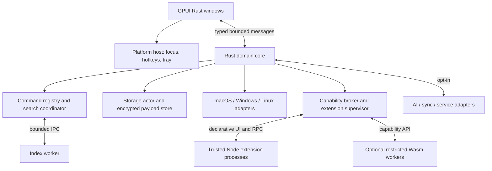

# A production Rust alternative to Raycast

Design baseline: 11 November 2026. Status: proposed architecture and implementation plan, not an implemented or benchmarked application. The application UI is Rust, as requested. JavaScript/TypeScript is optional for third-party extension compatibility, not the application renderer.

## 1. Recommendation and product contract

**Build a Rust desktop application using GPUI, a renderer-independent Rust core, platform-specific integration crates, and a separately supervised extension runtime.** Start with a four-week feasibility phase. Make the framework decision final only after real Windows, macOS and Linux tests pass. Use Slint as the first alternative if GPUI cannot meet the agreed accessibility/input requirements; Slint uses its own declarative UI language with Rust logic. Iced remains another Rust option, but its accessibility maturity needs particular scrutiny.

The product should reproduce the fast keyboard workflow: summon, type, select, act, and return to the previous application. It should eventually cover the broader productivity platform, including extensions, notes, clipboard, snippets, window management, AI and optional sync. Do not make the first usable launcher depend on completing that entire platform.

Proposed commitments:

- Free, open-source desktop software with no artificial feature caps, mandatory account, advertising, or subscription unlocks.
- Offline core: application/file search, arithmetic, notes, snippets, clipboard and window commands remain useful with no service connection.
- Rust for the application UI, core services, indexing, storage, platform adapters, extension broker and optional server.
- Consistent interaction patterns across macOS, Windows and Linux, with truthful per-platform capability reporting.
- An independently implemented extension API and migration path, plus tested compatibility for selected Raycast extension versions.
- Optional local AI, bring-your-own-provider AI, and self-hosted sync. Third-party inference, hosting, signing and hardware can still cost money.
- Accessibility, reliable text input, durable data and safe updates are release requirements.

Use a new product name and original visual assets. “Raycast-like” describes the functional reference. It does not require copying branding or proprietary implementation details.

### What “feature parity” means

Track four different outcomes: workflow parity, feature coverage, extension API compatibility, and operational quality. A calculator menu entry does not establish calculator parity; a successful React list example does not establish store-wide compatibility. Record parity for a specific reference build, feature scenario, OS and permission state.

The current public Raycast manual covers a much wider surface than its original launcher: AI agents, skills, projects, automations, dictation and screen context are part of the reference scope. Raycast also publishes a Windows product. Freeze a release-specific reference during implementation rather than using “latest Raycast” as a moving acceptance criterion. [Raycast manual](https://manual.raycast.com/), [Windows product](https://www.raycast.com/windows)

## 2. Evidence, assumptions and limits

This plan uses current official product documentation, public SDK documentation, upstream framework sources and OS API specifications. It contains no decompiled Raycast code or observations of a running Raycast instance.

The REA skill was read and its evidence discipline applied. No REA analysis tools were exposed in this session. A bounded search of three common Windows installation locations found no target; the packaged-app inventory was inaccessible. A version-pinned REA doctor attempt could not download its package because npm DNS resolution failed. No client configuration was changed. These facts do not prove Raycast is absent or that its registration is broken. No REA Evidence IDs were generated.

Consequently, Raycast's exact ranking formula, database structure, private protocols, timing and memory use remain unknown. Public documentation is sufficient for this architecture plan; build-specific behavioral capture remains Phase 0 work. All numbers below are proposed engineering targets or planning estimates, not measured results.

Planning assumptions: desktop first; a funded team of 6–8 people or equivalent contributor capacity; actual test hardware for all three operating systems; consumer workflows before enterprise administration; no mobile client in desktop 1.0. These are adjustable planning inputs, not facts supplied by the user.

## 3. UI framework decision

| Framework | Fit for this application | Main concern | Decision |
|---|---|---|---|
| **GPUI** | Rust rendering, highly custom keyboard-driven desktop surfaces, coherent custom design system | Pre-1.0 change rate; production quality of accessibility, IME, panels and editors must be demonstrated | Primary candidate |
| **Slint** | Rust integration, declarative components, desktop backends and accessibility integration | Slint DSL rather than exclusively Rust source; licensing choice; dynamic extension views and rich editor work | First fallback after matching spike |
| **Iced** | Rust UI and a clear state/update model | Accessibility and complex input/editor completeness must pass the pinned-version gate | Evaluate if GPUI fails and all-Rust source is strict |
| **egui/eframe** | Rust, flexible rendering, useful tooling ecosystem | More product-specific work for polished text-heavy launcher/notes workflows | Useful for development tools; not preferred shell |
| **Tauri 2** | Rust host with mature web UI ecosystem | Standard approach puts the application UI in web languages | Keep as a contingency only if the Rust UI preference changes |

GPUI's upstream README describes it as pre-1.0 and warns about frequent breaking changes. Its current source includes accessibility integration; that is evidence of implementation work, not proof that this application's screen-reader journeys will pass. Pin a tested release or immutable commit rather than a moving branch. [GPUI README](https://github.com/zed-industries/zed/blob/main/crates/gpui/README.md), [GPUI accessibility source](https://github.com/zed-industries/zed/blob/main/crates/gpui/src/_accessibility.rs)

Reusable GPUI and the full Zed application have different license boundaries. Do not assume Zed's editor or every widget can be copied under GPUI's license. Audit candidate component crates, including the current GPUI Kit, before adopting them. Build an application-owned wrapper so upstream widgets do not become the domain API. [Zed software overview](https://zed.dev/software-overview), [GPUI Kit](https://github.com/longbridge/gpui-kit)

Slint and Iced deserve a small comparison prototype if GPUI hits a blocker, rather than a second complete application. Check the actual release's backend and licensing conditions. [Slint backends](https://github.com/slint-ui/slint/blob/master/docs/development/window-backend-integration.md), [Slint licensing](https://slint.dev/get-started), [Iced repository](https://github.com/iced-rs/iced), [Iced accessibility tracking](https://github.com/iced-rs/iced/issues/552)

Raycast's published v2 architecture combines native platform hosts, a React webview frontend, Node and Rust. Its article also says it rejected Tauri during evaluation. This validates neither GPUI nor Tauri for our product; it shows that familiar behavior can be separated from a particular renderer. The all-Rust choice increases our responsibility for text editing and widgets. [Raycast architecture](https://www.raycast.com/blog/a-technical-deep-dive-into-the-new-raycast)

### Mandatory framework gate

Build a release-mode slice with a search input, 10,000 virtualized results, nested action panel, Markdown detail, validated form, multiline note and a slow mock extension. Test at 100%, 150% and 200% scaling. The spike must demonstrate:

1. Reliable summon/hide and focus restoration over 1,000 cycles, including fullscreen apps, multiple monitors, virtual desktops, sleep and lock.
2. VoiceOver, NVDA/Narrator and Orca workflows on the declared supported systems. Search input, result selection, actions, forms, errors and notes must expose useful semantic information. Virtualized lists expose logical count/position, stable selected identities, offscreen navigation and announcements while the search field retains text focus. Editor tests include accessible text ranges and selection read/write.
3. CJK composition, Hindi shaping, RTL text, emoji, dead keys and AltGr; caret-aligned candidate windows; Enter/Escape must respect active composition.
4. Acceptable warm-open, typing, idle memory and power against Section 14's budgets.
5. A text editor with stable selection, undo/redo, clipboard and accessibility. A beautiful list is insufficient evidence for Notes parity.
6. Valid behavior on weak/unsupported GPU configurations or an explicit installer/runtime support check and helpful failure path.

If critical input or accessibility problems cannot be fixed in a bounded additional two-week effort, run the same slice in Slint. Do not start twelve months of feature work on an unproven foundation. Assign one maintainer to GPUI upgrades and upstream fixes throughout development.

## 4. Product scope and parity map

Priority definitions: **A** daily-driver foundation; **B** production desktop 1.0; **C** broad personal parity; **D** team/cloud expansion. These are scope levels, not claims that everything Raycast offers fits into 1.0.

| Area | Required behavior | Priority | Acceptance boundary |
|---|---|---|---|
| Launcher | Global summon, root search, favorites, aliases, recent/frequent commands, per-command shortcuts | A | Keyboard complete; no stale query results; conflicts explained |
| Action/navigation system | Primary/secondary actions, searchable action panel, nested views, breadcrumbs, toasts | A | Stable selected identity; predictable Escape/back and return focus |
| App catalog | Launch/switch, reveal, refresh after installation/uninstallation | A | Packaged/desktop apps deduplicated; missing targets handled |
| File search | Paths/names, filters, preview, open/reveal/copy path; optional content indexing | A/B | Scoped roots; no implicit cloud downloads; rename/delete reconciliation |
| Calculator | Arithmetic, precision policy, units, dates/time zones; cached currencies | A/B | Deterministic fixtures; dimensional errors; rates show age/source |
| Quicklinks | URL/path templates, arguments, preferred opener, aliases/tags | A | Correct encoding; no shell interpolation |
| Emoji/symbols | Local search, variants, recent/favorite items, copy/paste | A | Correct graphemes and screen-reader names |
| Clipboard | Text/images/files, search, format-aware paste, pins, retention, exclusions | B | Concurrent copy safe; sensitive formats excluded; bounded storage |
| Snippets | Search/manual insertion, placeholders, import/export, tags; automatic expansion | B/C | IME/secure-input boundaries; clipboard/focus recovery |
| Notes | Separate Rust window, durable edits, Markdown, search, tasks, links, export | B/C | No loss of acknowledged saves; selection/undo round-trips |
| Window management | Halves/thirds/quarters, maximize/center, restore, move display, layouts | B/C | DPI/work-area/minimum-size aware; supported adapter required |
| App navigation | Window switcher, application menu search, deep links | B/C | Lifecycle-safe target IDs; disabled actions remain disabled |
| Scripts | Metadata, arguments, output modes, explicit interpreters, cancellation | B | Bounded output; kill owned descendants; missing dependency errors |
| Extensions | List/Grid/Detail/Form/Actions, no-view commands, preferences, OAuth, store | B | Tested SDK contract and explicit trusted-code classification |
| Background extensions | Tray/menu commands, refresh schedule, event/resource lifetime | C | No unlimited permanent workers; pause/quota controls |
| Screenshot utilities | Search/preview/latest paste, local OCR, QR extraction | C | Explicit source scopes and file deletion semantics |
| System utilities | Volume/media, sleep/lock, appearance, quit/auto-quit, run commands | B/C | Each command advertises permissions and platform limits |
| Focus and key remapping | Timer, app/site rules, Hyper Key-style behavior | C | No stuck modifiers; clear escape hatch; separate integrations |
| Calendar/browser | Calendar events/join links; bookmarks/tabs via browser extension | C | Per-service authorization; native messaging identity validation |
| Themes | Light/dark/high contrast, density, colors, custom themes | B/C | Themes are data; contrast warnings and reset always available |
| AI chat/commands | Streaming, attachments, reusable prompts, local/BYOK providers | C | Core works without AI; transparent context and cancel |
| Dictation/translation | Mic indicator, transcription, formatting, paste; language options | C | Local path available; audio retention explicit |
| Screen awareness | Selected text/focused-window content/screenshots | C | User-triggered capture, preview/redaction, platform permissions |
| Agents/skills/projects | Saved tools/instructions, local skills, project chats/memory | C | Instructions cannot grant capabilities; memory inspectable |
| MCP/tools | Transport adapters, auth, tool/resource discovery, host permission broker | C | Server/tool identity bound to grants; hostile output handled |
| Automations | Durable schedules, retries, history, missed-run policy | C/D | DST/reboot/offline behavior; no blind retry of effects |
| Sync | Optional E2EE settings/links/snippets/notes, devices, conflict recovery | D | Self-hostable; key recovery/revocation and offline edits tested |
| Teams | Shared collections, private registry, memberships/policy, audit | D | Personal/team scopes separated; future-access revocation |
| Enterprise/mobile | SSO/SCIM/MDM; iOS/Android companions | Later product tracks | Separate requirements and staffing, outside desktop 1.0 |

Reference details: [clipboard](https://manual.raycast.com/clipboard-history), [snippets](https://manual.raycast.com/snippets), [notes](https://manual.raycast.com/notes), [window management](https://manual.raycast.com/window-management), [AI agents](https://manual.raycast.com/ai/agents), [automations](https://manual.raycast.com/ai/automations). The companion `research-and-sources.md` maps the remaining categories to direct sources. Exact behavior on each OS is still a capture/test task.

For scope control, preserve two scorecards: all reference scenarios, and scenarios supported on a particular platform. Unsupported Wayland behavior stays visible on the first scorecard; it must not disappear from the denominator to create an inflated parity percentage.

## 5. Interaction and visual design

### Launcher composition

Start with an original compact surface approximately 760 logical pixels wide and 480 high, adapting between 600–960 pixels and to available screen space. These are design starting points, not measured Raycast dimensions. Use a search/header region, grouped virtualized results, an optional detail pane, and a footer showing the primary action and action-menu shortcut. Keep the selected row visually unmistakable.

Use a 4-point spacing scale, comfortable 40–48 pixel result rows, 14–16 pixel text as a default, scalable typography, and separate tokens for background, raised panels, text, muted text, selection, borders and danger. Fonts come from the OS unless a redistributable font is selected. Blur/translucency is optional; opaque mode must look complete. Animate only small state changes, and respect reduced motion.

Build these Rust primitives first: SearchField, ResultList, ResultRow, SectionHeader, ActionPanel, Breadcrumb, DetailPane, MarkdownView, FormField, ShortcutRecorder, Toast, Dialog, EmptyState, PermissionNotice and ProgressRow. Every primitive must define keyboard handling, focus ownership, accessibility semantics, loading/error states and scaling behavior before its visual polish is considered finished.

### Keyboard contract

| Input | Proposed action |
|---|---|
| Configured global shortcut | Show launcher on chosen monitor; toggle only according to explicit setting |
| Up/Down, Page Up/Down | Move selection without changing search-field text focus |
| Enter | Primary action of the currently selected stable result |
| Cmd+K on macOS / Ctrl+K elsewhere | Open searchable action panel; user-rebindable |
| Escape | Let IME/modal handle first, then close action panel, pop child view, finally hide root |
| Tab/Shift+Tab | Move among actual controls; never trap keyboard users |
| Back navigation shortcut | Restore parent query, selection and scroll position |
| Shortcut recorder | Display native modifier names and report registration conflicts |

On empty search show pinned/frequent items and useful recent actions, with configurable history. Default hotkeys must be conflict-checked; offer a shortcut choice in onboarding. Per-command shortcuts bypass root search but enter the same action and permission pipeline.

Treat results as `loading`, `ready`, `partial`, `empty`, `failed` or `unavailable`. A slow remote provider must not hide fast local matches. Keep selected identity stable when late results arrive; while the user is navigating, avoid moving the selected item under their cursor. Display the exact target and effect for consequential actions.

### First-run and settings

First-run takes the user through shortcut selection and app launching, then offers clipboard and optional integrations. Request accessibility, microphone, screen capture and filesystem access when a related feature is enabled. Settings include General, Commands, Search Roots, Clipboard, Snippets, Notes, Windows, Extensions, AI, Sync, Privacy, Appearance and Diagnostics. An integration status page explains unavailable capabilities and a working alternative.

The application has one resident launcher plus lazily opened Notes, Chat and Settings windows. Each surface uses the same Rust design system. Do not recreate the launcher window on every summon unless measurement justifies it.

## 6. Architecture and process boundaries



**Keep the first version a modular desktop application, not a network of microservices.** One non-elevated per-user main process owns the OS event loop, UI and core orchestration. Async work runs on a runtime with bounded task queues; blocking SQLite and CPU-heavy work do not run on the UI thread. A separate index worker handles large scans and content extraction. Extensions run in separate processes; model inference is a separate optional service/process.

The command registry, ranking and preferences live independently of GPUI. Native calls that require the main thread are scheduled through an explicit dispatcher. Do not move AppKit/UI handles into arbitrary async tasks. Unsafe FFI is confined to small reviewed platform modules.

A core crash may terminate the UI in this design. Persist state safely and rely on ordinary relaunch; do not pretend a separate index process protects against every app crash. Worker crashes are individually recoverable. Only split the entire core into a daemon if measured lifecycle needs justify the added IPC and security surface.

### Workspace layout

```text
apps/desktop/               executable, startup, window composition
apps/cli/                   invoke/search/open/preferences commands
crates/domain/              IDs, commands, actions, errors, policy types
crates/core/                orchestration and service lifecycle
crates/ui-gpui/             renderer, navigation and view adapters
crates/ui-components/       owned widgets, themes, accessibility contracts
crates/platform-api/        capability and native host traits
crates/platform-macos/      Apple APIs, thread affinity, permissions
crates/platform-windows/    Win32/COM/UIA adapters
crates/platform-linux/      XDG, X11, portals, compositor adapters
crates/search/              normalization, ranking, provider orchestration
crates/indexer/             catalog, crawling, reconciliation, extraction
crates/storage/             SQLite migrations, payloads, backups
crates/clipboard/           capture, filtering, retention and insertion
crates/snippets/            template parser and expansion state machine
crates/window-manager/      geometry, targets, layouts and restore history
crates/extension-protocol/  wire schema, validation and generated bindings
crates/extension-host/      process lifecycle, grants, resource accounting
crates/ai/                 providers, context, tools, transcription
crates/sync/                records, conflict handling, encrypted envelopes
packages/extension-sdk/    optional TS/React developer API
packages/raycast-compat/   independent compatibility adapter
services/registry/         optional registry metadata and publishing
services/sync-server/      optional self-hostable ciphertext service
tests/conformance/         behavioral and SDK fixtures
tests/platform/            real desktop integration scenarios
docs/adr/                  architectural decisions and support matrix
```

Use ordinary Rust crates for Tokio, Serde, SQLite access and structured logging after maintenance/license/security review. Candidate search/storage components are `nucleo-matcher`, `rusqlite`, SQLite FTS5 and `notify`; lock exact versions during Phase 0. The named tools are implementation candidates, not a validated dependency lockfile. [nucleo matcher](https://docs.rs/nucleo/latest/nucleo/struct.Matcher.html), [rusqlite](https://docs.rs/rusqlite/latest/rusqlite/), [FTS5](https://www.sqlite.org/fts5.html), [notify](https://docs.rs/notify/latest/notify/)

## 7. Core contracts, concurrency and action execution

The following is illustrative contract design, not compiling implementation:

```rust
struct CommandDescriptor {
    id: CommandId,
    title: String,
    keywords: Vec<String>,
    requirements: Vec<CapabilityRequirement>,
    kind: CommandKind,
}

struct QueryContext {
    invocation: InvocationId,
    revision: u64,
    text: String,
    scope: SearchScope,
    deadline: Instant,
}

struct SearchBatch {
    invocation: InvocationId,
    revision: u64,
    provider: ProviderId,
    items: Vec<ResultItem>,
    complete: bool,
}

enum CapabilityStatus {
    Available,
    PermissionRequired,
    TemporarilyUnavailable,
    Unsupported,
    Degraded { reason: String, fallback: String },
}
```

IDs are namespaced and stable. Display names are never execution identities. Results carry opaque action references resolved by the host, not shell command strings. At action time re-check target existence, permissions and relevant revision. A UI callback is bound to its extension instance and invocation; an extension cannot select another extension's identity in an RPC field.

Every query gets a monotonically increasing revision within a launcher invocation. Cancel old work cooperatively and ignore late batches regardless of whether cancellation succeeded. Use bounded channels, queue limits and provider deadlines. Coalesce intermediate UI updates instead of rendering every network token or match. No lock is held across network or IPC awaits.

Model side effects as `prepare -> authorize -> execute -> reconcile`. Preparation identifies a concrete target and parameters. Authorization uses stored capability grants plus any necessary action-specific confirmation. Execution returns an outcome and operation ID. Reconciliation checks observable effects where possible. Retries are safe only for idempotent operations or providers with idempotency keys; an uncertain send/delete result must not be silently retried.

Local IPC uses inherited pipes for workers, and a per-user authenticated socket/named pipe for the optional CLI. Apply OS access controls, protocol version negotiation, message size/depth limits, timeouts and peer identity checks. Do not expose a localhost HTTP control port by default. Deep links are untrusted input and cannot silently invoke dangerous commands.

## 8. Search and indexing design

Separate three workloads: a small in-memory command/app catalog, large file metadata retrieval, and optional document content search. Do not fuzzy-scan every filesystem path on every keystroke.

1. Normalize input with explicit Unicode/case rules while retaining original display text and byte-safe match mappings.
2. Route direct paths, command aliases and recognized calculator expressions early. Calculator evaluation has strict CPU/input limits and never calls a shell.
3. Search commands/apps/snippets/links in memory with a reused matcher. Retrieve file candidates through indexed prefixes/tokens, then rerank a bounded set.
4. Rank in explicit tiers: exact alias, exact title, title prefix, token match, fuzzy match, fallback. Within a tier use bounded favorite/frequency/recency signals and stable ID tie-breaking.
5. Keep frequency boosts capped so a frequently used weak match does not beat an exact alias. Store ranking signals locally and offer reset/private mode.
6. Apply provider quotas and category labeling. Remote extensions opt into particular search scopes or prefixes rather than receiving every typed query.

Maintain golden query fixtures, typo/Unicode corpora and user-approved relevance examples. Record top-1 accuracy, recall@10 and reciprocal rank per category; tune on one set and validate on another. Do not assert reproduction of Raycast's unknown ranking formula.

The indexer scans user-selected roots with exclusions, stores file identity/volume/path/mtime/size/kind, and reconciles filesystem events. It owns a separate rebuildable index database; the core storage actor alone writes the durable user database. Bound index batches and give interactive work and note saves priority over scans. Watchers are hints: overflow, atomic replacement, network volumes and dropped events require rescans. `notify` explicitly documents event limitations; a watcher alone is not an authoritative catalog. [notify limitations](https://docs.rs/notify/latest/notify/)

Avoid symlink loops, recursive permission escalation, hidden cloud hydration and uncontrolled parsing. Skip caches/build trees by default. Use per-root quotas, low-priority workers, battery-aware scheduling and progress/cancel controls. Optional content extraction runs out of process with file-size, memory and time limits. Start with text/Markdown; add PDF/Office extractors only with a dedicated dependency/security budget.

Use native search services as optional providers, not as the sole cross-platform source of truth. Label source and freshness. File search must still work on explicitly indexed roots when a platform search service is disabled.

## 9. Storage and data lifecycle

Use SQLite with migrations and a single writer actor, bounded read connections and explicit transactions. Keep user-owned durable records separate from rebuildable indexes and caches. Enable foreign-key enforcement and choose journal/synchronous settings from crash tests rather than speed folklore.

| Logical collection | Important fields / constraints |
|---|---|
| `commands`, `command_preferences` | Stable ID, enabled, alias, hotkey, favorite, revision |
| `usage_events` / aggregates | Command ID, bounded count/recency; no query text by default |
| `apps`, `file_entries`, `index_roots` | Platform identity, root/volume, generation, exclusion policy |
| `quicklinks`, `snippets` | UUID, structured template, tags, modified revision, tombstone |
| `notes`, `note_revisions`, `attachments` | Document format version, durable edit sequence, encrypted body/blob references |
| `clipboard_items`, `clipboard_blobs` | Keyed digest, formats, source confidence, captured/expiry time, pin state |
| `extensions`, `extension_versions`, `grants` | Package hash, SDK/runtime range, trust mode, grant revision |
| `layouts`, `window_restore` | Logical geometry, monitor affinity, window identity/generation |
| `jobs`, `job_runs` | Schedule/timezone, lease, attempt, idempotency and outcome |
| `sync_outbox`, `sync_heads`, `devices` | Authenticated revisions, pending operations, key epoch |

Separate credential references from ordinary preferences. Store keys/tokens through OS secret storage. Encrypt persistent sensitive payloads, including clipboard history and related thumbnails; do not leak the same content into an unencrypted full-text index. For the first version use a bounded ephemeral clipboard search index rebuilt from decrypted permitted history. If large encrypted FTS becomes necessary, evaluate an audited encrypted-SQLite distribution and its packaging/license separately.

When secure storage is unavailable on Linux, offer a passphrase-backed vault or memory-only sensitive history. Never silently downgrade to plaintext. Encryption at rest does not protect data from malware already controlling the user's unlocked session.

Clipboard filtering runs before persistence, preview generation or indexing. Honor supported sensitive/history-exclusion formats, including Windows exclusion markers; enforce configured app/MIME exclusions, item/byte limits, pause and private mode. App attribution may be incomplete, so it cannot be the sole secret filter. On OS/vault lock, stop capture, clear decrypted search indexes and previews, and release key material where feasible. Resume only after authorization/unlock; rebuild the bounded in-memory index. [Windows clipboard formats](https://learn.microsoft.com/en-us/windows/win32/dataxchg/clipboard-formats)

Notes acknowledge “saved” only after the intended durable commit; batch keystrokes with a short debounce and flush on blur/close. Use an edit journal and recovery view for uncommitted work. The initial editor can use Markdown source plus preview; full WYSIWYG/task/block parity is a separate C-level milestone with composition, selection and undo tests.

Imports use explicit exported files and a preview. Migrate supported aliases, links, snippets and preferences with per-item errors. Never scrape credentials from another application's private database. Exports include versioned JSON and readable Markdown plus attachments. Backups are consistent database snapshots; include encryption and restore verification. Every irreversible schema migration takes a restorable snapshot.

Deletion atomically removes payloads, thumbnails and search entries, supersedes pending content uploads, and enqueues an authenticated tombstone for synced records. Retain deletion metadata until the acknowledgement/compaction policy permits removal; otherwise offline devices can resurrect content. Specify trash retention versus immediate deletion. Do not promise forensic erasure from SSDs or third-party backups.

## 10. OS integration and capability model

| Capability | macOS | Windows | Linux X11 | Linux Wayland |
|---|---|---|---|---|
| Global summon | Native shortcut/panel adapter | RegisterHotKey and native window activation | Desktop binding or passive grab | GlobalShortcuts portal where implemented; desktop CLI binding fallback |
| App discovery | Bundles and platform metadata | Start Menu and packaged apps | XDG desktop entries | XDG entries within available filesystem scope |
| Clipboard history | Pasteboard change tracking | Clipboard listener message loop | Selection-owner observation | Supported compositor integration only; no universal promise |
| Paste to previous app | Checked focus and permitted input route | Checked HWND/focus plus UIPI-limited input | WM/input route | Supported session/compositor route, otherwise copy-only |
| Window geometry | Accessibility attributes where exposed | Win32 geometry/work area | Window-manager requests | Compositor-specific integration; otherwise unavailable |
| Automatic snippets | Permission-aware input observation | Hooks/input with integrity limits | Input observation/injection | Not generally available; manual snippet insertion remains useful |
| Selected text/menu search | Accessibility API, app dependent | UI Automation, app dependent | App/toolkit integration | Explicit copy or app-specific integration |
| Screen capture | Permission-aware capture | Supported capture APIs | Desktop adapter | Screenshot/ScreenCast portals |
| Indexing | User-granted roots | User-readable roots | User-readable roots | Same, plus packaging/portal restrictions |

Windows explicitly restricts `SendInput` across integrity boundaries, and foreground activation can be denied. Do not solve this by running the entire launcher as administrator. [SendInput](https://learn.microsoft.com/windows/win32/api/winuser/nf-winuser-sendinput), [SetForegroundWindow](https://learn.microsoft.com/en-us/windows/win32/api/winuser/nf-winuser-setforegroundwindow)

The XDG Clipboard portal extends other sessions; it is not a universal independent background clipboard-history service. The GlobalShortcuts interface also depends on a working desktop backend. Publish a tested GNOME/KDE/wlroots compositor/version/package matrix. Do not assume XWayland gives unrestricted access to native Wayland windows. [Clipboard portal](https://flatpak.github.io/xdg-desktop-portal/docs/doc-org.freedesktop.portal.Clipboard.html), [GlobalShortcuts portal](https://flatpak.github.io/xdg-desktop-portal/docs/doc-org.freedesktop.portal.GlobalShortcuts.html)

Native integration code can use Rust bindings to Apple/Windows/Linux APIs. Small ABI bridges may still be needed; that does not introduce a JavaScript application UI. On macOS, permissions are asynchronous and revocable. [Accessibility trust API](https://developer.apple.com/documentation/applicationservices/1459186-axisprocesstrustedwithoptions)

### Correct paste and snippet behavior

At summon, capture previous process/window identity, monitor and invocation generation. Before insertion, verify the target still exists, permissions still apply and the user has not independently switched targets. Hide the launcher, request focus, and verify as far as the platform permits. If restoration fails, copy the item and report that manual paste is needed.

Clipboard-based paste tracks ownership/version. Do not restore an older value over a newer user copy. Do not restore after an arbitrary short timer that may precede asynchronous clipboard consumption; default to leaving the selected value in the clipboard unless a tested route can safely restore it. Preserve rich formats only when available and requested. A successful input API return does not prove the destination accepted the content.

Automatic snippet expansion uses a short in-memory trigger buffer, clears on focus/layout/composition changes, respects detectable secure-input modes, and provides a global pause. It never persists general keystrokes. Context detection is imperfect; exclusions and platform limitations must be visible. Test grapheme deletion and selection replacement rather than assuming one character equals one keypress.

### Window geometry

Represent geometry in logical coordinates with explicit conversion to physical pixels. Use work areas, window minimum sizes and monitor IDs that survive common reconnect patterns. Store restore state per live window generation, not just PID or recycled handle. Read geometry back to detect clamping/failure. Layout application is best effort across several independent windows: present partial success and offer restore rather than claiming an atomic transaction.

## 11. Extension architecture and compatibility

**An all-Rust application UI is compatible with React-authored extensions.** The extension runs React with a custom reconciler, emits a constrained view tree, and the Rust renderer displays that tree. No extension DOM or JavaScript is injected into the main application. Raycast's public API already uses host-provided components; compatibility still requires implementing lifecycle, storage, native calls and utilities. [Raycast API introduction](https://developers.raycast.com/)

Define protocol nodes for List, Grid, Detail, Form, ActionPanel, sections, accessories, metadata, validation and progress. Preserve keyed node identity and opaque callback IDs. Define snapshot and patch messages with sequence numbers and resynchronization on missed patches. Cap depth, node count, message size, image decoding and outstanding callbacks. Large lists use ranges/data windows rather than transmitting a new complete tree per keystroke.

Render Markdown through a safe Rust parser and allowlisted render model. Treat links, images, attachment paths and rich-text payloads as untrusted. Remote images go through a broker with size/redirect controls. The host-rendered protocol does not allow extension nodes to replace trusted identity chrome or impersonate application permission dialogs. Unconfined trusted code can create its own OS windows; this renderer restriction is not a system-wide anti-spoofing guarantee.

### Runtime classes

| Class | Execution | Security meaning | Release order |
|---|---|---|---|
| Built-ins | Reviewed Rust code | Trusted application boundary | A |
| TS/React compatibility extensions | Separate pinned Node process per active extension, bounded pool/lifetime | Trusted third-party code unless independently proven OS confinement exists | B |
| Local scripts/native helpers | Explicit interpreter/process, separate supervisor | Trusted code with user's OS privileges | B |
| Portable Rust/Wasm extensions | Wasmtime worker with narrowly exposed host calls | Restricted capability model; host/runtime vulnerabilities remain possible | C, after broker stabilizes |

Process separation protects responsiveness and crash containment. It does not by itself protect files, network or secrets. Node's own permission model explicitly does not defend against malicious code. Never advertise unconfined compatibility workers as sandboxed or their displayed permissions as comprehensive enforcement. Broker policies govern broker calls; arbitrary Node calls can bypass them in trusted mode. [Node permissions](https://nodejs.org/api/permissions.html)

For the Wasm tier, expose no ambient filesystem, sockets, environment or process execution. Grant handles to explicit resources, bound host work, and combine fuel/epoch interruption with wall-clock cancellation and process termination. A blocked host operation also needs its own deadline. [Wasmtime security](https://docs.wasmtime.dev/security.html), [execution interruption](https://docs.wasmtime.dev/examples-interrupting-wasm.html)

### Manifest and permissions

Each package declares identity, version, license, source, SDK range, supported platforms, commands, assets, preferences, trust class, background needs and requested capabilities. Bind approvals to publisher/package identity and permissions; updates requesting more access require review. Capabilities include current clipboard versus history, selected text, screen capture, picked read/write roots, hosts/ports, application launch, window control, notifications, AI requests and secret-backed service calls.

Use a broker-generated identity and grant context, never a claimed extension ID. File access checks must handle traversal, symlinks and races with directory handles. Network scopes must re-check redirects and resolved destinations, including local/private services when not granted. Prefer brokered authorized HTTP calls over returning raw secrets. If trusted code receives a secret, be honest that it can exfiltrate it.

OAuth uses the system browser and authorization-code + PKCE where the service supports it. Bind state, redirect, issuer/provider, expiry and callback to the initiating extension and authorization session; never take identity from a deep-link parameter. Namespace credentials per extension/account, serialize refreshes, support cancellation and logout/revocation, and register the project's own provider client IDs. Native-app guidance and PKCE are defined in [RFC 8252](https://www.rfc-editor.org/rfc/rfc8252) and [RFC 7636](https://www.rfc-editor.org/rfc/rfc7636). Service-specific behavior requires integration fixtures.

### Compatibility ladder

1. Own SDK with a stable documented contract and complete test fixtures.
2. Source-porting tool that rewrites imports and reports unsupported APIs and OS assumptions.
3. Selected unmodified source extensions through an independent API shim, published with exact tested versions and OS combinations.
4. Optional platform-specific helpers implemented individually; unsupported AppleScript/private binaries/service entitlements remain explicit.

Start with 50 representative extensions, stratified across components, OAuth, pagination, clipboard, filesystem, subprocess and background behavior. Expand to 200 for the broad-parity milestone. Report tested-corpus compatibility separately from store-wide compatibility. Audit each package's licensing, bundled assets and service access; the public extension repository does not confer rights to every related artifact or private backend. [Raycast extension repository](https://github.com/raycast/extensions)

Registry MVP can be a signed, versioned static catalog with immutable hashed packages. Include source link, license, supported OS, trust mode, permissions, changelog and compatibility results. Check archive traversal, symlinks, decompression limits and dependencies. Build packages in isolated CI; installation must not run unreviewed lifecycle scripts. Support pinning, rollback, revocation and local installs. A signature establishes publisher identity/integrity, not that code is harmless.

## 12. AI, agents and automations

AI is a provider interface in Rust, separate from local search. Normalize streaming text, tool calls, attachments, usage, errors, model capability metadata and cancellation. Begin with an existing local inference endpoint plus a provider-neutral HTTP adapter; avoid embedding multiple large model runtimes into the launcher. Downloadable speech/OCR/model packages are optional, with verified hashes and licenses.

AI context is assembled from explicit selections: prompt, selected text, selected files, chosen notes or a user-triggered screenshot. Show destination and context before first use and when scope expands. Do not send root-search keystrokes, clipboard history or screens to a remote provider by default. Local processing still needs limits and visible capture state.

Implement saved prompts, chat history, attachments and model switching first. Then add agents, project context, editable memory and skill files. Skill text and tool output are data, not authority to expand grants. Host-initiated MCP and extension tool calls pass through the same action broker. Local stdio servers are executable code and require explicit trusted-code installation approval; without proven OS confinement they can act directly with user privileges, outside the broker. Remote tools may have service-side effects governed by their credentials. Pin protocol/SDK versions and use conformance tests rather than assuming every server behaves identically.

Separate planning from side effects. Display concrete target/parameters for consequential brokered tool calls; allow narrowly scoped pre-authorized automation policies. A prompt injection in a page, document, extension result or skill must not confer broker permissions. This guarantee applies to the enforced host boundary, not arbitrary actions by installed unconfined code. Keep execution history metadata separate from sensitive chat content.

Dictation requires a recording state machine tied to actual microphone ownership, cancel behavior, bounded buffers, transcription progress and safe paste. Retain audio only by explicit setting. Translation and text cleanup can use local or selected remote models with clear quality/latency expectations.

The scheduler persists time zone, recurrence, next run, run ID, lease and outcome. Use monotonic time for running durations and wall-clock/calendar rules for schedules. Define skipped/missed-run policy, DST gaps/folds, sleep/resume, manual retry and duplicate suppression. Device-local schedules run only while that device can execute them; an always-on optional self-hosted worker is a separate deployment. Effects are not universally exactly-once.

The reference categories are documented here: [dictation](https://manual.raycast.com/ai/dictation), [screen awareness](https://manual.raycast.com/ai/screen-awareness), [skills](https://manual.raycast.com/ai/skills), [projects](https://manual.raycast.com/ai/projects), [local models](https://manual.raycast.com/ai/local-models).

## 13. Optional sync and collaboration

Sync is not required for startup, licensing or local use. Ship an open-source self-hostable server and an optional hosted instance if sustainable funding exists. Start with settings, quicklinks and snippets. Add notes once concurrent-edit semantics are stable. Do not sync clipboard history, credentials, machine-specific hotkeys or executable script bodies by default.

This is also a useful reference distinction: Raycast's current sync documentation explicitly excludes clipboard history, credentials and script bodies. Cross-device clipboard is an additional feature, not a prerequisite for matching that documented sync behavior. [Raycast Cloud Sync](https://manual.raycast.com/cloud-sync)

Use a reviewed E2EE protocol/library design, not custom cryptographic primitives. Specify device enrollment, a random workspace root key, device identities, authenticated envelopes, collection keys, unique nonces, key epochs, rotation and recovery keys. The server sees routing metadata, timing and sizes even when contents are encrypted. Commission review before release.

Settings use field revisions with deterministic resolution. Conflicting snippets/quicklinks preserve both versions when silent merging would surprise the user. Notes begin with conflict copies; introduce a vetted CRDT only when collaborative editing requires it. Tombstones, offline-device watermarks, compaction, replay rejection and rollback detection must be part of the protocol. Revoked devices may retain old plaintext; rotation protects future data, not history already learned.

Teams add separate workspaces, roles, shared collections, private registry and administrator policy. Never move personal clipboard or notes into a team scope automatically. Server-side membership checks and encrypted key distribution must both change on revocation. SSO/SCIM/MDM should be a later funded track with its own threat model and support commitments.

## 14. Performance and quality budgets

These are initial targets for named reference machines, subject to Phase 0 measurement. Choose one midrange Windows laptop with integrated GPU/16 GB RAM, one Apple Silicon Mac, and one supported Linux laptop. Add an 8 GB low-end class and virtual/remote sessions as separate profiles. Use release builds, record power mode, OS, compositor, display scale, corpus and warm/cold state.

| Metric | Initial target | Measurement rule |
|---|---|---|
| Warm hotkey to usable launcher | p95 ≤75 ms; p99 ≤120 ms | Internal trace plus external display/input validation |
| Keystroke to correct local result list | p95 ≤50 ms | 10k command corpus; separate file-index corpus |
| UI frame work | p95 under 16.7 ms at 60 Hz | Typing, scrolling, action panel and streaming updates |
| Cold startup to usable shell | p95 ≤1.5 s | 30 launches per machine; index rebuild excluded but reported |
| Baseline resident memory | Aim ≤150 MiB settled, ceiling review at 250 MiB | Entire attributable process tree with settled indexer and zero extension/model workers; report native OS metric |
| Idle CPU | Average ≤0.5% of one logical core over 30 min | Include clipboard-enabled and disabled profiles; report wakeups |
| File query | p95 ≤100 ms for cached candidates | 1 million-entry synthetic index plus realistic roots |
| Extension cold start | p95 ≤500 ms for local fixture | Separate process startup from remote API latency |
| Search cancellation | No stale presentation or action | Flood queries and delayed/out-of-order providers |
| Durability | No loss of acknowledged saved edits | Kill/power-loss simulation around persistence boundaries |

Do not equate RSS, working set, private bytes and PSS across systems. Report each precisely and include GPU allocations where measurable. Add separate active-index, one-extension and five-extension profiles; optional model memory has its own budget. Track startup/indexer/Node costs separately. Performance regressions above an agreed threshold require investigation; tighter targets are earned by benchmarks, not assumed from Rust.

## 15. Security, reliability and distribution

Threat model: malicious extensions/packages, hostile content and images, compromised update hosting, incorrect IPC authorization, accidental sensitive retention, provider failures and local data corruption. A malicious OS administrator or fully compromised user session is outside the protection promised by application encryption.

Keep the launcher non-elevated. Use a narrow installation/update helper only if packaging requires one. Enforce archive limits, safe image decoding, protocol bounds, content sanitization and permission revocation mid-operation. Secrets, clipboard text, note bodies, queries and full paths are excluded from logs by default. Crash dumps may contain sensitive memory: offer a reviewed/redacted opt-in report rather than automatic full uploads.

Release artifacts need platform signing where applicable, notarization for normal macOS distribution, Linux package signatures and verified update metadata. Use TUF or an equivalently reviewed update design with offline root, key rotation, expiry and rollback protection. Stage downloads, verify hashes/signatures before install, replace atomically and recover from interruption. An operator-approved rollback must respect database compatibility and snapshot restore. [Apple distribution](https://developer.apple.com/developer-id/), [TUF threat model](https://theupdateframework.io/docs/security/)

Proposed initial packaging: signed macOS bundles for supported architectures, signed Windows installer plus package-manager metadata, Linux deb/rpm and a portable artifact after dependency validation. Treat Flatpak as a separate capability profile because confinement affects desktop integrations. Do not claim every package format has identical access. Only label an architecture supported when it has an exercised release pipeline and integration tests.

Define the minimum OS/backend versions in Phase 0 from the pinned GPUI build and tested APIs. At 1.0 target currently vendor-supported macOS/Windows releases and named Linux distribution/compositor combinations. Avoid an untested promise to support all versions a dependency can theoretically compile for.

Publish SBOMs, dependency licenses, provenance, SECURITY.md, vulnerability contact, support window, migration policy and recovery instructions. Isolate signing credentials from pull-request builds. Measure reproducibility for unsigned payloads; signed/notarized artifacts need separate verification. Budget regular dependency updates, emergency runtime patches and registry moderation.

## 16. Testing and release gates

| Test layer | Critical scenarios |
|---|---|
| Unit/property | Unicode ranking, template grammar, path normalization, geometry conversion, schedule rules |
| Protocol/fuzz | Malformed trees/RPC, oversized messages, archive traversal, image/text payloads |
| Storage/fault injection | Kill during write/migration, low disk, corrupt DB, backups and schema downgrade |
| Extension conformance | Each supported API/lifecycle fixture; React reconciliation; Node version upgrades |
| Native integration | Hotkeys, focus, paste, permissions, windows, monitor changes, sleep/lock |
| Accessibility/input | Real screen readers, IME, keyboard-only, scaling, high contrast, reduced motion |
| Security | Revocation, cross-extension access, SSRF/redirects, symlink races, update tamper/replay |
| Sync/scheduler | Concurrent offline edits, tombstones, revoked devices, DST, duplicate/uncertain effects |
| Performance/soak | Hot path percentiles, 72-hour residency, worker crash storms, large indexes |

Use synthetic data in automated fixtures. Build a native test harness that invokes core commands and inspects accessibility/host state; GPUI UI tests need actual app/platform coverage. Screenshots test appearance but cannot establish focus, text composition or screen-reader correctness. Remove debug IPC/test hooks from production artifacts.

1.0 gates: all A and committed B scenarios pass on each advertised platform; zero unresolved critical/high exploitable security issues; no reproducible loss of acknowledged saved data; safe upgrade and restore drill; signed clean-machine installation; documented capability limits; core journeys usable with screen readers. A Wayland-specific missing capability can be a declared product limitation, but must not be marketed as tested full parity.

Run a six-week beta with daily use on every advertised platform, regression triage and staged updates. Stop feature additions before the release candidate; spend the final period on correctness, docs and recovery.

## 17. Delivery plan, staffing and estimates

These are planning ranges for 6–8 experienced contributors with stable availability and real hardware, not promises. Suggested ownership: two platform/core engineers, two UI/input/editor engineers, one extensions/security engineer, one search/storage engineer, and one QA/release specialist; product/design and specialist review can be shared or added. If the team is smaller, cut concurrent scope rather than expecting the same dates.

| Phase | Calendar window | Deliverable | Exit gate |
|---|---|---|---|
| 0: Evidence and feasibility | Weeks 1–4 | Versioned reference scenarios; GPUI slice on all OSes; threat model; packaging proof | UI/input/accessibility gates pass or framework pivot decided |
| 1: Daily launcher | Weeks 5–12 | Registry, app search, action panel, aliases, quicklinks, basic calculator, settings | Core interaction fixtures and warm-open target pass |
| 2: Local productivity | Weeks 13–24 | File index, clipboard, manual snippets, common window actions, Markdown notes | Crash recovery, focus/paste and supported-OS matrix pass |
| 3: Ecosystem | Weeks 21–36 | Node supervisor, declarative SDK, registry, scripts, 50-extension corpus | Host remains usable under hostile/malformed worker tests; compatibility report |
| 4: Production 1.0 | Weeks 33–60 | Editor/input polish, permissions, signing/updater, imports, accessibility, six-week beta | Section 16 release gates; no scope hidden behind “beta” |
| 5: Broad personal parity | Weeks 49–84 | Rich Rust Notes editor, advanced layouts/expansion, AI/dictation/context/MCP, Wasm tier, 200-extension corpus | Each capability passes platform/security gates; editor passes multilingual selection, undo, accessibility and recovery corpus |
| 6: Sync and teams | Weeks 73–112+ | Reviewed E2EE, self-host server, team sharing/policy, automation hosting | Recovery/key rotation/conflict and operational readiness drills |

A useful alpha is plausible in roughly 3–6 months; a reliable daily driver in 6–9; a production desktop 1.0 in roughly 12–15 months under these assumptions. Broad parity with the contemporary platform is an 18–30 month effort with continuing maintenance. A solo developer should expect multiple years for broad production parity and start with a much smaller desktop release. These estimates include integration and QA, but depend heavily on the GPUI/text-editor spike.

The critical path is input/accessibility/focus -> stable command and view contracts -> storage/native correctness -> extension compatibility -> release hardening. Assign one of the UI/input engineers explicit ownership of the rich Notes editor, starting its technical groundwork during Phase 2 and delivering full editor parity in Phase 5. AI and cloud features must not block the offline desktop foundation. Reserve approximately 20–30% of steady capacity for platform regressions, dependency updates, docs and support after beta.

First month work is detailed in the companion implementation backlog. All research-note phase labels are advisory; this table is the canonical delivery sequence.

## 18. Reuse, licensing and sustainability

Before committing to a greenfield implementation, spend three days evaluating whether contributing to an existing Rust launcher would satisfy the product goals. Gauntlet is a relevant Rust/React-extension reference; Vicinae is a useful native launcher/compatibility reference with a different primary stack. Flare is archived and should be treated as historical design evidence rather than an assumed maintained foundation. This is a build-versus-contribute investigation, not a claim that any already satisfies this plan. [Gauntlet](https://github.com/project-gauntlet/gauntlet), [Vicinae](https://github.com/vicinaehq/vicinae), [Flare](https://github.com/ByteAtATime/flare)

Proposed licensing direction: MPL-2.0 for the new application/server code and a permissive license for SDK/protocol libraries, subject to the final dependency audit and project goals. If a chosen UI dependency/component requires a different distribution model, resolve that before importing code. Keep an SPDX inventory, notices, source provenance and an original asset library. An open extension repository is not authorization to use a proprietary store service or private API.

Fund signing, CI, package hosting, security review and moderation through donations, sponsorship or optional managed hosting. Keep the self-hosted/server source and feature set available. Do not promise unlimited free hosted inference. Adopt contribution guidelines, small RFCs for SDK changes, two maintainers for release/signing recovery, and an explicit deprecation window.

## 19. Decisions and unresolved proofs

| Decision / question | Status |
|---|---|
| Rust application UI | Confirmed user preference; GPUI primary candidate |
| Renderer-independent Rust core | Proposed architectural decision |
| Optional JS/React extension runtime | Recommended for ecosystem parity; application UI remains Rust |
| Free offline core and self-host options | Required product direction |
| Cross-platform capability honesty | Required; generic Wayland parity cannot be assumed |
| GPUI accessibility/editor quality | Must prove in Phase 0 on pinned dependency |
| Exact reference behavior/build | Must capture; documentation survey completed |
| Universal Raycast extension compatibility | Not promised; corpus/version/OS results required |
| OS-level confinement of Node | Unproven; classify as trusted execution until tested |
| Latency/memory targets | Proposed, unmeasured |
| E2EE/update security | Design specified; implementation and external review required |
| Exact supported OS versions | Choose from tested Phase 0 artifacts |

The first implementation milestone is a small but complete Rust interaction slice: summon -> search -> action panel -> execute -> return focus, plus an accessible editor and real IME tests on every target OS. That milestone determines whether the rest of this plan has a dependable foundation.
